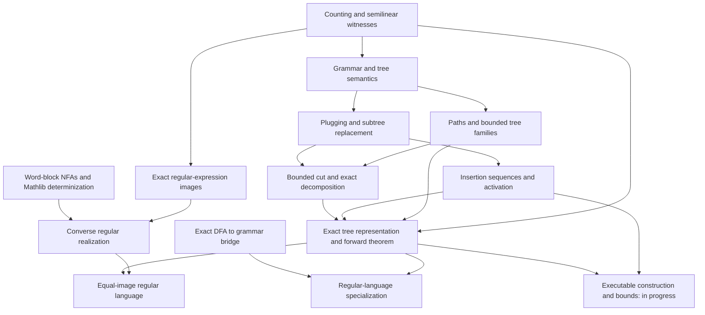

# Parikh's theorem in Lean

An independent Lean 4 library formalizing **Parikh's theorem**: the letter-count
vectors of a context-free language form a semilinear set. The development uses
Mathlib's languages, context-free grammars, and semilinear sets, so its results
can be used without translating to a separate language or grammar formalism.

To use the library, start with the [Lean interface](#lean-interface) below.
To learn the argument, read the [guided proof](docs/PROOF_GUIDE.md), which follows
one grammar from derivation trees to a finite union of linear sets.
The [module guide](#lean-architecture) locates each part in the source.

## The theorem

Let $\Sigma$ be a finite alphabet. For a word $w\in\Sigma^*$, its **Parikh vector**
$\Psi(w)\in\mathbb{N}^{\Sigma}$ records the number of occurrences of each letter:

```math
\Psi(w)(a)=|w|_a,
\qquad
\Psi(L)=\lbrace \Psi(w)\mid w\in L\rbrace.
```

A set is **linear** if it consists of one base vector plus arbitrary natural
multiples of finitely many period vectors. It is **semilinear** if it is a finite
union of linear sets.

**Parikh's theorem.** For every context-free language $L\subseteq\Sigma^*$, there
exist $m\in\mathbb{N}$ and, for each $1\leq j\leq m$, a base
$b_j\in\mathbb{N}^{\Sigma}$ and finitely many periods
$p_{j,1},\ldots,p_{j,k_j}\in\mathbb{N}^{\Sigma}$ such that

```math
\Psi(L)=\bigcup_{j=1}^{m}
\left\lbrace b_j+\sum_{i=1}^{k_j}n_i p_{j,i}
\;\middle|\;n_1,\ldots,n_{k_j}\in\mathbb{N}\right\rbrace.
```

Here $\mathbb{N}$ includes zero. An empty union represents the empty set, and a
component with no periods is a singleton. This is an exact equality: every
represented vector is realized by a word in $L$. The theorem is due to
[Rohit J. Parikh (1966)](https://doi.org/10.1145/321356.321364).

For example, $L=\lbrace a^n b^n\mid n\in\mathbb{N}\rbrace$ has the linear Parikh image
$\lbrace (0,0)+n(1,1)\mid n\in\mathbb{N}\rbrace$. The regular language $(ab)^*$ has the same
image, although its words have a different order of letters.

The converse says that **every semilinear set is the Parikh image of a regular
language**. For a linear component, choose words $u_b,u_{p_1},\ldots,u_{p_k}$
with the required count vectors and use $u_b(u_{p_1})^*\cdots(u_{p_k})^*$;
then take a finite union. Together the two directions imply that every
context-free language has the same Parikh image as some regular language.
Both directions and the equal-image regular realization are proved in Lean.
The separate `regular_image` theorem proves semilinearity for every DFA-regular
language, using a right-linear Mathlib grammar with exactly the DFA's word language.

### Lean interface

Import the library and apply its language-level theorem:

```lean
import Parikh

example {T : Type*} [Finite T] [DecidableEq T]
    (L : Language T) (hL : L.IsContextFree) :
    IsSemilinearSet (Parikh.image L) :=
  Parikh.contextFree_image L hL
```

`Parikh.Vector T` is `T → ℕ`, `counts w` counts letters, and
`Parikh.image L` is `counts '' L` (the set image under counting).
`Component T` stores a base and a finite list of periods; `Witness T` is a finite
list of components with an exact set-valued `denotation`.

The grammar-level results are `Parikh.grammar_image` and
`Parikh.grammar_witness`. The latter returns an existential witness `W` satisfying
`W.denotation = Parikh.image g.language`. They impose no finiteness or decidable
equality assumption on the ambient nonterminal type `g.NT`: the finite grammar
rules determine the relevant nonterminals. Witness existence is currently a
classical proof; it is separate from an executable grammar-to-witness compiler.
`Parikh.converse` realizes any semilinear set as a DFA-regular language, and
`Parikh.regular_realization` gives a regular language with the same image as a
given grammar. These are also classical existence results.

## How the proof works

The proof asks where the bases and periods of a semilinear set come from.
A complete derivation tree can be cut into a small **base tree** and bounded
**cycle contexts**. A context has a hole with the same nonterminal as its root,
so it can be inserted around a matching subtree repeatedly. Each insertion adds
the same terminal-count vector: this is a period.

There is one complication: a context may need a nonterminal introduced by an
earlier insertion. An **activation order** records how a chosen family becomes
available. Once every chosen context has been inserted once, further repetitions
are independent. Their compulsory first copies contribute to the base vector;
extra copies contribute arbitrary multiples of the periods.

There are finitely many bounded bases and contexts. Taking the union over their
activatable choices gives a finite union of linear sets. Decomposing trees proves
that every word is represented; reconstructing trees proves that every represented
vector comes from a word. The [guided proof](docs/PROOF_GUIDE.md) develops these
steps through an example, including empty productions and zero-weight cycles.

The mechanization follows the repository's [proof exposition](reference/parikh_theorem.tex),
an adaptation of the derivation-tree approach presented by
[Sin'ya (2019)](https://arxiv.org/abs/1909.09393) and
[Rubtsov (2022)](https://arxiv.org/abs/2301.00047). Sin'ya attributes the
underlying decomposition method to Takahashi's 1970 thesis. This is not a
line-by-line formalization of Parikh's original paper. Rubtsov's related proof
is explicitly nonconstructive; the planned executable compiler is a separate
part of this library. The [proof plan](docs/PROOF_PLAN.md) maps source labels to
Lean declarations, and the [Mathlib reuse audit](docs/MATHLIB_REUSE.md) explains
which existing library results are used.

## Lean architecture

All project declarations live in namespace `Parikh`. The proof is organized
around the mathematical dependencies below; the arrows summarize proof flow,
not every Lean import.



| File | What it contains |
| --- | --- |
| [Parikh.lean](Parikh.lean) | Public import entry point. |
| [Statements.lean](Parikh/Statements.lean) | Main grammar/language theorems and exact tree-image equality. Start here to use the library. |
| [Counting.lean](Parikh/Counting.lean) | Parikh vectors, component/witness denotations, counting laws, and both bridges to Mathlib semilinearity. |
| [GrammarTrees.lean](Parikh/GrammarTrees.lean) | `ParseTree`, validity, completeness, contexts, statistics, grammar/tree equivalence, and bounded-height finiteness. |
| [TreePlugging.lean](Parikh/TreePlugging.lean) | Validity, size, terminal counts, and support when holes are filled. |
| [TreeReplacement.lean](Parikh/TreeReplacement.lean) | Positions, matching subtree occurrences, and extraction of one-hole contexts. |
| [ParseTreePaths.lean](Parikh/ParseTreePaths.lean) | Production-label paths, support, and the longest-path characterization of height. |
| [BoundedCutSupport.lean](Parikh/BoundedCutSupport.lean) | Minimal non-simple subtrees, reversible replacement, and height/size facts for cutting. |
| [Decomposition.lean](Parikh/Decomposition.lean) | Insertion, simple-tree height, the bounded-cut lemma, and exact decomposition. |
| [InsertionSequences.lean](Parikh/InsertionSequences.lean) | Root, completeness, weight, size, and support accounting over insertion sequences. |
| [Activation.lean](Parikh/Activation.lean) | Abstract activation, first occurrences, positive multiplicities, their realization by trees, and the linear-component equality. |
| [ActivationAlgorithm.lean](Parikh/ActivationAlgorithm.lean) | Executable activation testing with a proved exact Boolean result, using finite enabled batches. |
| [FiniteRepresentation.lean](Parikh/FiniteRepresentation.lean) | Finiteness of bases and bounded cycles, and semilinearity of their union. |
| [GrammarImage.lean](Parikh/GrammarImage.lean) | Shared exact tree-image equality and forward semilinearity, keeping public declarations in `Statements.lean`. |
| [DFAGrammar.lean](Parikh/DFAGrammar.lean) | A finite DFA as a Mathlib right-linear grammar, with proved equality of their word languages. |
| [WordBlockAutomata.lean](Parikh/WordBlockAutomata.lean) | Finite continuation-language NFAs and DFA regularity for fixed-word and starred-word prefixes, reusing Mathlib determinization. |
| [RegularRealization.lean](Parikh/RegularRealization.lean) | Representative words, component/witness expressions, exact images, DFA regularity, the converse, and regular-language specialization. |
| [Construction.lean](Parikh/Construction.lean) | Finite grammar encoding, algorithm contracts, proved bounded-family cardinality/weight bounds, and outstanding witness size/bit bounds. |
| [BoundedFamilySupport.lean](Parikh/BoundedFamilySupport.lean) | Finite syntax covers and height induction for quantitative tree counts and terminal-yield length. |
| [BoundedEnumeration.lean](Parikh/BoundedEnumeration.lean) | Executable enumeration of valid open trees up to any height, with an exact membership proof. |

The remaining folders support reading, building, and reviewing the proofs:

| Path | Purpose |
| --- | --- |
| [reference/](reference/) | The mathematical exposition in LaTeX and PDF, with reproduction instructions. |
| [docs/](docs/) | Detailed proof plan, status ledger, build guide, Mathlib reuse notes, contract-audit guide, and agent handoff. |
| [docs/contracts/](docs/contracts/) | Accepted baseline, append-only declaration fingerprints, and explicit unresolved-obligation lists. |
| [scripts/ContractAudit.lean](scripts/ContractAudit.lean) | Exports elaborated declaration contracts and axiom dependencies from Lean. |
| [scripts/check-contracts.py](scripts/check-contracts.py) | Checks frozen contracts and both direct and transitive proof obligations. |
| [scripts/SkeletonExamples.lean](scripts/SkeletonExamples.lean) | Small semantic examples, including empty productions, activation, and witness edge cases. |
| [scripts/build-reference.sh](scripts/build-reference.sh) | Rebuilds the reference PDF from its preserved LaTeX source. |
| [.github/workflows/lean.yml](.github/workflows/lean.yml) | CI for the build, contract/axiom audit, and examples. |
| [lean-toolchain](lean-toolchain), [lakefile.toml](lakefile.toml), [lake-manifest.json](lake-manifest.json) | Pinned Lean version, Lake package configuration, and exact dependency revisions. |
| [AGENTS.md](AGENTS.md) | Repository instructions for incremental agent-assisted development. |

## Current status and contributing

The forward theorem, exact finite semilinear witnesses, converse, equal-image
regular realization, and regular-language specialization are proved. These results
allow arbitrary ambient nonterminal types; witness and automaton existence use classical reasoning.

Executable activation testing and bounded-tree enumeration are implemented with
correctness proofs. Base/cycle cardinalities and leaf-weight bounds are proved.
Grammar-to-witness compilation remains, together with two theorem obligations
concerning witness size and bit bounds.
The [proof-status ledger](docs/PROOF_STATUS.md) lists the exact
obligations; a successful build can still contain these tracked `sorry`s.

Contributors should use the [proof plan](docs/PROOF_PLAN.md) to locate a result
and the [contract guide](docs/CONTRACT_CHECKS.md) to understand statement stability.
The accepted statements and definition meanings stay fixed while separate PRs
complete proofs. The [agent handoff](docs/CODEX_FORMALIZATION_PROMPT.md) describes
the incremental development workflow.

## Build and proof checks

The project pins **Lean 4.34.1** and an exact Mathlib revision. Follow the
[build guide](docs/BUILD.md) to install elan and fetch the selected Mathlib cache.
Then run from the repository root:

```sh
lake build
python3 scripts/check-contracts.py
lake env lean scripts/SkeletonExamples.lean
```

The accepted statements and supporting definition meanings are frozen; proofs
are completed in separate, reviewable PRs. Intermediate holes are listed
explicitly, including declarations that depend on them indirectly. The stricter
`python3 scripts/check-contracts.py --final` rejects all remaining project holes
and project-added axioms; it is expected to fail while the ledger lists unfinished
obligations. Standard Lean foundational axioms are reported separately.
See [contract checks](docs/CONTRACT_CHECKS.md) for the full policy.

## References

1. Rohit J. Parikh. **On Context-Free Languages.** *Journal of the ACM* 13(4),
   570–581, 1966. [DOI: 10.1145/321356.321364](https://doi.org/10.1145/321356.321364).
   Original theorem.
2. Ryoma Sin'ya. **Simple proof of Parikh's theorem à la Takahashi.** 2019.
   [arXiv:1909.09393](https://arxiv.org/abs/1909.09393).
   Derivation-tree decomposition, adjunct trees, and activation by first uses.
3. Alexander Rubtsov. **The Simplest Proof of Parikh's Theorem via Derivation
   Trees.** Submitted 30 December 2022.
   [arXiv:2301.00047](https://arxiv.org/abs/2301.00047).
   Related decomposition-and-pumping proof with a nonconstructive presentation.
4. **Mathlib**, pinned revision
   [`d13f23b`](https://github.com/leanprover-community/mathlib4/tree/d13f23b723b8a846827a245b89c10fc7d3f11612).
   Reused formal foundations; see the [module reuse audit](docs/MATHLIB_REUSE.md).
