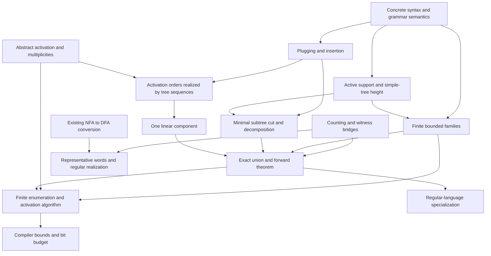

# Accepted proof plan

The owner accepted the statement skeleton in PR #2 on 2026-10-11.
The counting/witness, grammar/tree semantics, plugging/insertion, abstract activation laws,
activation's tree realization, the exact linear-component equality, active support,
and simple-tree height bounds are proved;
Parikh's theorem remains in progress.
Read the complete reference, including appendices, alongside the
statements; source labels below refer to `reference/parikh_theorem.tex`.

## Reading order and module purposes

1. `Parikh/Statements.lean`: the forward theorem, exact finite witness, language
   interface, and equal-image regular realization.
2. `Parikh/Counting.lean`: concrete indexed witness denotation and the bridges to
   Mathlib's `IsLinearSet` and `IsSemilinearSet`.
3. `Parikh/GrammarTrees.lean`, `ParseTreePaths.lean`, `TreePlugging.lean`, `TreeReplacement.lean`, then `Decomposition.lean`: ordered production trees,
   explicit holes, Mathlib derivation semantics, occurrence replacement, and the
   bounded cut measured by production count.
4. `Parikh/InsertionSequences.lean` and `Activation.lean`: sequence accounting,
   syntax-independent support transitions, first occurrences, positive
   multiplicities, their tree realization, and the proved exact component formula.
5. `Parikh/RegularRealization.lean`: representative words and explicit finite
   regular expressions; the DFA-regularity obligation applies to these expressions.
6. `Parikh/Construction.lean`: finite encoded input, algorithm interfaces, and all
   four size bounds plus the numerical bit budget.
7. `PROOF_STATUS.md` and `CONTRACT_CHECKS.md`: what is incomplete and how acceptance
   freeze the accepted contracts.

## Intended proof dependencies

These are intended dependencies for the remaining proof. The four counting/witness
contracts, grammar/tree equivalence, plugging/insertion, the two abstract activation laws,
sequence/tree realization, `one_linear`, active support, and simple-tree height
now have complete proofs, as do `bounded_open_finite`, `bounded_cut`, `decomposition`,
and `treeRepresentation_eq`. The remaining 11 theorem bodies
are still `sorry`. No forward proof depends on the converse,
trace theory, a grammar normal form, or Presburger elimination. The finite-witness
bridge to Mathlib is separate from the derivation-tree proof.

## Source-to-contract map

Names below are in namespace `Parikh`. “Pending” means a tracked theorem hole.
Concrete definitions and interfaces are implemented; their correctness proofs
and algorithm values are pending.

| Source labels | Lean declaration(s) | Hypotheses / meaning | Intended prerequisites; status |
| --- | --- | --- | --- |
| `sec:statement`, `eq:word-add` | `counts`, `image`, `counts_append` | Terminal equality; counts are `List.count` | Mathlib `List.count_append`; proved |
| `sec:statement`, `eq:preview` | `Component.denotation`, `Witness.denotation`, `component_isLinearSet`, `witness_isSemilinearSet`, `exists_witness` | Independent natural coefficients over indexed period lists | Mathlib finite-range additive closure and finite unions; all bridges proved |
| `def:tree`, `def:statistics` | `ParseTree`, `Valid`, `Complete`, `ParseTree.frontier`, `yield`, `weight`, `productionSize`, `height`, `support` | Exact production membership and ordered child-root matching | Mathlib grammar rules and symbols; concrete |
| `prop:tree-word`, `app:derivations` | `derives_iff_tree` | Every grammar, root and word; no finite `g.NT` hypothesis | Partial-tree expansion and existing rewrite context lemmas; proved |
| `eq:word-context` | reused `ContextFreeRule.Rewrites.append_left`, `append_right` and grammar derivation adapters | Prefix/suffix closure | Reuse Mathlib one-step and multistep prefix/suffix closure directly; no parallel adapter needed |
| `def:cycle`, `eq:cycle-root` | `OneHole`, `Cycle`, `Cycle.root_mem_support` | Exactly one matching hole, positive production count; root lies in support | Definitions concrete; root-in-support consequence proved |
| `lem:plug`, `eq:plug-wt`, `eq:plug-size`, `eq:plug-supp` | `plugging` | Valid one-hole context and matching complete tree | Structural induction with hole-count accounting; proved |
| `def:insertion`, `lem:enabled` | `Inserts`, `insertion_enabled` | Position selects an internal matching subtree | Plugging and occurrence existence; proved |
| `lem:insertion-laws`, `eq:insert-wt`, `eq:insert-size`, `eq:insert-supp` | `insertion_accounting` | Complete insertion and exact root/weight/size/support equalities | Outer one-hole context and plugging twice; proved |
| `cor:sequence` | `InsertionSequence.accounting` | Finite ordered sequence from a complete tree; exact root/weight/size/support and completeness | Induction using insertion accounting; proved |
| `lem:simple-height`, `def:families`, `def:statistics` | `ParseTree.Simple`, `ParseTree.labelPath_subset_support`, `ParseTree.exists_labelPath_height`, `simple_height`, `IsBase`, `IsBoundedCycle` | Active nonterminals replace an unnecessarily finite ambient type; repeated siblings are allowed | Longest label path, path-label distinctness, active support, and Mathlib finite-set cardinality; height bound proved, family predicates concrete |
| `lem:finite`, `def:statistics` | `activeNonterminals`, `Valid.support_active`, `complete_support_active`, `bounded_open_finite`, `BoundedEnumeration` | Finite terminals; holes restricted to active symbols for the general grammar | Active-support containment and bounded-family finiteness proved; executable enumerator pending |
| `lem:cut` | `bounded_cut`, `Complete.exists_minimal_nonsimple_subtree`, `ParseTree.exists_root_mem_child_support`, `ParseTree.height_le_height_plug`, `ParseTree.productionSize_subtree_bound`, `ParseTree.subtree_replacement` | Non-simple complete tree; strict decrease in production count | Descent to simple children, repeated root, bounded context, indexed reversible surgery; proved |
| `thm:decomposition`, `eq:decomposition`, `cor:finite-generation` | `decomposition`, `InsertionSequence.append` | Exact tree reconstruction for every complete tree/root | Mathlib natural strong induction using bounded cut, followed by sequence concatenation; proved |
| `def:activation`, `eq:activation` | `ActivationOrder`, `Activatable`, `ContextsActivatable` | Operations retain their identities and require previously present labels | Concrete definitions; arbitrary support sets in the abstract interface |
| `lem:activation-realize`, `eq:activated-wt`, `eq:activated-supp` | `activationOrder_iff_insertionSequence`, `ContextsActivatable.realize` | Matching cycle list; introduce each selected context once, with exact accounting and all selected contexts enabled afterwards | Insertion enabledness and sequence accounting; proved |
| `lem:first-occurrence` | `first_occurrences` | Any enabled list of operations | Filter later repeats whose added support is already present; proved |
| `lem:multiplicities` | `positive_multiplicities` | Required label belongs to added support; multiplicities positive on selected set | Initial activation pass, then finite replicas with exact counts; proved |
| `prop:one-linear`, `eq:one-linear`, `eq:component-base`, `eq:component` | `contextComponent`, `contextComponent.mem_denotation_iff`, `one_linear` | Complete base and activatable set; every selected context contributes once before arbitrary extra copies | List-count finite sums, Mathlib additive closure, multiplicities, tree lifting; proved |
| `thm:main`, `eq:main` | `treeRepresentation`, `treeRepresentation_eq`, `InsertionSequence.contextsActivatable` | Exact image equality; finite terminal alphabet and arbitrary Mathlib nonterminal type | Decomposition, first-occurrence activation, `one_linear`, semantics bridge; equality proved |
| `thm:main` | `grammar_witness` | Exact finite semilinear witness | Main equality, bounded-family finiteness, and counting/witness bridges; pending |
| `thm:parikh-statement` | `grammar_image`, `contextFree_image`, `regular_realization` | Mathlib grammar/language interfaces | Main equality and witness bridge; regular realization also uses converse; pending |
| `sec:example`, `eq:example-target` | `scripts/SkeletonExamples.lean` | The required order is C then E; E alone is disabled | Small support checks pass; full example grammar is deferred |
| `eq:representative` | `AlphabetOrder`, `representative`, `representative_counts` | Explicit exhaustive, repetition-free alphabet list | List counting; pending law, concrete construction |
| `lem:linear-regular`, `thm:converse`, `eq:regular-construction` | `componentExpression`, `witnessExpression`, `witnessExpression_correct`, `converse` | Finite alphabet; exact image and Mathlib DFA regularity | Word-count laws; existing NFA/DFA conversion where useful; pending |
| regular specialization of `thm:parikh-statement` | `regular_image` | Any Mathlib DFA-regular language | Future thin DFA-to-CFG adapter, or direct finite-path specialization; pending |
| `lem:activation-test` | `ActivationTest` | Finite operation data with decidable equality | Finite enabled-operation search; algorithm value pending |
| `sec:effective` | `EncodedGrammar.decode`, `BoundedEnumeration`, `Compiler` | Numeric finite syntax; no classical-choice compiler value | Enumeration, activation test, exact tree formula; implementation pending |
| `eq:bound-defs`, `lem:count-trees` | `GrammarSize`, `grammarSize`, `bounded_family_bounds` | `n` is active cardinality, `b ≥ 1`, `M = ∑ᵢ₌₀ⁿ⁺¹ bⁱ`, `K = (1+d+n+p)^M` | Injection into bounded position records; pending |
| `thm:size-bound` | `WithinBounds`, `bounded_witness`, `Compiler.bounded` | At most `K2^K` components, `K` periods, norms `M` / `(K+1)M` | Bounded syntax and exact construction; pending |
| `eq:bit-bound` | `coordinateBits`, `vectorBits`, `entryBits`, `witness_bit_bound` | Fixed widths using Mathlib `Nat.clog`; excludes list-length metadata | Four size bounds and nonnegative coordinates; pending |
| `app:presburger` | consequence of `Witness.denotation`; formula adapter deferred | Explicit existential coefficients | Downstream arithmetic consequence, not a proof prerequisite |
| `sec:formalization`, `app:notation` | this plan and concrete witness/tree/activation definitions | Proposed review contract | Documentation |

## Generality and edge-case review

Mathlib allows an infinite `g.NT`. `activeNonterminals` is exactly the start plus
all rule inputs and RHS nonterminals. Valid production nodes therefore lie in a
finite alphabet. Arbitrary standalone holes would make a bounded-height family
infinite, so `ActiveOpen` explicitly restricts hole labels. The grammar/tree
equivalence itself remains quantified over every original nonterminal. Bounds
use active cardinality without assuming that unreachable/unproductive symbols
can generate words. No grammar normalization or language change is assumed.

Terminal `DecidableEq` supports concrete occurrence counts, and can be supplied
classically; it imposes no combinatorial restriction. Public existence theorems
use `Finite T`. Quantitative sums use `Fintype T`; executable interfaces use `Fin`.

Empty alphabets, languages, words and productions are meaningful: a zero-arity
production has size/height one, yield empty, and its LHS in support. A hole has
zero size/height/weight and empty support. Unit and zero-weight cycles still have
positive production count. Period lists preserve zeros and duplicates. Different
branches may repeat labels without violating simplicity. Ambiguity is permitted:
all denotations are sets, with no uniqueness assumptions. Positions select
occurrences, and equal context weights never identify distinct context syntax.
The first occurrence of every selected context is included in the component's
base. Both inclusions of each equality remain explicit obligations.

`TreePlugging.lean` provides four supporting theorems for `lem:plug`: matching-hole
validity/root preservation, production-count accounting, terminal-count accounting,
and exact support membership. These are proved for arbitrary hole counts and
specialized to the accepted one-hole statement in `Decomposition.lean`.

`TreeReplacement.lean` adds three supporting theorems for insertion: no-hole side
branches are unchanged by plugging; support gives exactly a nonterminal subtree
occurrence in a complete tree; cutting out a selected occurrence yields a valid
one-hole context and an exact replacement identity. The insertion statements
remain in their original positions in `Decomposition.lean`.

`Activation.lean` provides three support lemmas for the abstract activation laws:
filtering operations whose added support is already covered, enabling any list
whose required labels are present, and appending operations covered by an earlier
pass. First-occurrence reduction uses no self-support assumption; multiplicities
use the accepted self-support hypothesis and Mathlib's existing list counting
and sum lemmas.

`InsertionSequences.lean` proves cycle-root membership in support and sequence
accounting, including completeness/root preservation and exact production count.
The two tree-realization adapters in `Activation.lean` relate enabled cycle lists
to insertion sequences in both directions, then specialize to a finite activatable
set. `List.sum_toFinset` changes the distinct list sum to the source's finite-set
sum. All selected cycles remain enabled afterwards.

`one_linear` proves both inclusions of the exact weight equality. Its coefficient
adapter reindexes the period list by context identities through Mathlib's existing
additive-closure characterization. `Finset.sum_list_map_count` changes sequence
weights to context multiplicities. Each selected context occurs at least once,
so subtracting one gives a natural coefficient; conversely, positive
multiplicities and the tree-realization adapter build a sequence using each
context its coefficient plus one times. Equal and zero context weights remain supported.

`Valid.support_active` uses production membership to place every production-node
label in the finite active alphabet, including in open trees. The accepted
`complete_support_active` follows by specialization. `ParseTreePaths.lean`
connects production-label paths to support and realizes production height with
a longest path. `simple_height` applies simplicity to that path, identifies its
length with its finite-set cardinality, and bounds it by the active cardinality.
The proof counts production nodes; holes and terminals contribute no labels,
empty productions still contribute one, and repeated siblings remain allowed.

`bounded_open_finite` inducts on the production-height bound. The leaves range
over finite terminals and active holes. Each finite production fixes its child
arity; Mathlib's `List.finite_length_eq` on the previous family's finite subtype
gives finitely many child lists. Validity supplies matching length, child validity,
and inherited active holes; a child's height is bounded by the list maximum.
Finite images and unions cover the node cases. The proof establishes semantic
finiteness without changing syntax or imposing a finite ambient nonterminal type.
Executable enumeration remains a separate implementation obligation.

`BoundedCutSupport.lean` supplies five structural adapters for `bounded_cut`.
Descent through non-simple children finds an occurrence whose children are simple;
its repeated path label must include the root. The existing support/subtree bridge
locates a proper descendant with that root, and the existing one-hole-context
construction cuts it out. Simple child heights and monotonicity of height under
plugging bound the context. Proper-subtree production counts and exact plugging
accounting prove strict decrease. Reversible indexed replacement preserves the
selected position and reconstructs the whole tree by reinsertion, including all
side branches and their order. No definition or frozen statement is changed.

`decomposition` uses Mathlib's `Nat.strong_induction_on`, quantified over all
complete trees with the given production count. A simple tree is its own base
with an empty context list. Otherwise `bounded_cut` gives a strictly smaller
complete tree with the same root. The induction hypothesis decomposes that tree;
`InsertionSequence.append` concatenates its reconstruction with the final
reinsertion. List membership preserves the bounded-cycle property of every
context. The new sequence adapter is a direct induction on the existing relation,
without changing its constructors or introducing another reconstruction relation.
No finite alphabet or nonterminal assumption is needed. The proof is semantic
existence; executable decomposition remains separate work.

`InsertionSequence.contextsActivatable` extracts matching roots from actual
insertion steps, recovers the enabled list using the existing activation/tree
equivalence, and applies `first_occurrences` to its distinct context set.
`treeRepresentation_eq` then proves both inclusions. A represented vector is
realized by `one_linear`; sequence accounting retains a complete start tree,
whose yield belongs to the grammar language by `derives_iff_tree` and Mathlib's
`mem_language_iff`. Conversely, a generated word gives a complete tree,
`decomposition` gives its bounded context list, the activation adapter certifies
that list's distinct set, and `one_linear` places its exact weight in the
corresponding component. Semilinearity and finite witness construction remain
the next milestone; the equality proof does not enumerate bounded families.

## After review

The accepted baseline is `6bff9679d7ea03e5401815b80c5a3dc1300f9d36`.
Complete one coherent milestone per PR: counting/witness bridges; tree semantics; surgery; abstract activation;
bounded syntax/cut; decomposition; main equality; regular realization; executable
construction; bounds. Add only helpers needed by the current milestone. Public
statements and supporting meanings remain frozen after acceptance.
