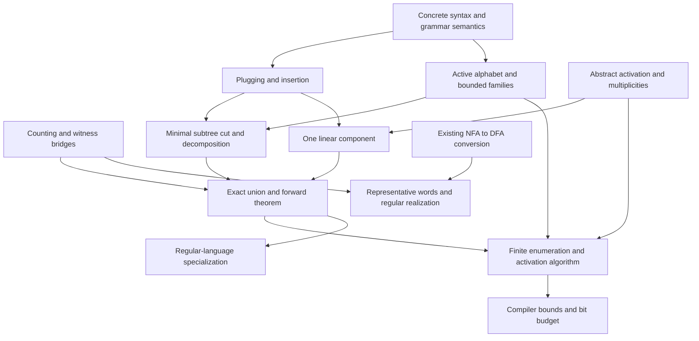

# Accepted proof plan

The owner accepted the statement skeleton in PR #2 on 2026-10-11.
The counting/witness and grammar/tree semantics milestones are proved; Parikh's theorem remains in progress. Read the complete reference, including appendices, alongside the
statements; source labels below refer to `reference/parikh_theorem.tex`.

## Reading order and module purposes

1. `Parikh/Statements.lean`: the forward theorem, exact finite witness, language
   interface, and equal-image regular realization.
2. `Parikh/Counting.lean`: concrete indexed witness denotation and the bridges to
   Mathlib's `IsLinearSet` and `IsSemilinearSet`.
3. `Parikh/GrammarTrees.lean`, then `Decomposition.lean`: ordered production trees,
   explicit holes, Mathlib derivation semantics, occurrence replacement, and the
   bounded cut measured by production count.
4. `Parikh/Activation.lean`: syntax-independent support transitions, first
   occurrences, positive multiplicities, and the exact component formula.
5. `Parikh/RegularRealization.lean`: representative words and explicit finite
   regular expressions; the DFA-regularity obligation applies to these expressions.
6. `Parikh/Construction.lean`: finite encoded input, algorithm interfaces, and all
   four size bounds plus the numerical bit budget.
7. `PROOF_STATUS.md` and `CONTRACT_CHECKS.md`: what is incomplete and how acceptance
   freeze the accepted contracts.

## Intended proof dependencies

These are intended dependencies for the remaining proof. The four counting/witness
contracts and grammar/tree equivalence now have complete proofs; the other 23 theorem bodies remain `sorry`. No forward proof depends on the converse,
trace theory, a grammar normal form, or Presburger elimination. The finite-witness
bridge to Mathlib is separate from the derivation-tree proof.

## Source-to-contract map

Names below are in namespace `Parikh`. “Pending” means a tracked theorem hole.
Concrete definitions and interfaces are implemented; their correctness proofs
and algorithm values are pending.

| Source labels | Lean declaration(s) | Hypotheses / meaning | Intended prerequisites; status |
| --- | --- | --- | --- |
| `sec:statement`, `eq:word-add` | `counts`, `image`, `counts_append` | Terminal equality; counts are `List.count` | Mathlib `List.count_append`; proved |
| `sec:statement`, `eq:preview` | `Component.denotation`, `Witness.denotation`, `component_isLinearSet`, `witness_isSemilinearSet`, `exists_witness` | Independent natural coefficients over indexed period lists | Mathlib finite-range additive closure and finite unions; all bridges proved |
| `def:tree`, `def:statistics` | `ParseTree`, `Valid`, `Complete`, `ParseTree.frontier`, `yield`, `weight`, `productionSize`, `height`, `support` | Exact production membership and ordered child-root matching | Mathlib grammar rules and symbols; concrete |
| `prop:tree-word`, `app:derivations` | `derives_iff_tree` | Every grammar, root and word; no finite `g.NT` hypothesis | Partial-tree expansion and existing rewrite context lemmas; proved |
| `eq:word-context` | reused `ContextFreeRule.Rewrites.append_left`, `append_right` and grammar derivation adapters | Prefix/suffix closure | Reuse Mathlib one-step and multistep prefix/suffix closure directly; no parallel adapter needed |
| `def:cycle`, `eq:cycle-root` | `OneHole`, `Cycle` | Exactly one matching hole, positive production count | Root-in-support consequence deferred; definitions concrete |
| `lem:plug`, `eq:plug-wt`, `eq:plug-size`, `eq:plug-supp` | `plugging` | Valid one-hole context and matching complete tree | Induction on hole path; pending |
| `def:insertion`, `lem:enabled` | `Inserts`, `insertion_enabled` | Position selects an internal matching subtree | Plugging and occurrence existence; pending |
| `lem:insertion-laws`, `eq:insert-wt`, `eq:insert-size`, `eq:insert-supp` | `insertion_accounting` | Complete insertion and exact root/weight/size/support equalities | Plugging twice; pending |
| `cor:sequence` | `InsertionSequence`; future accounting helper | Finite ordered sequence | Insertion accounting; helper deliberately deferred |
| `lem:simple-height`, `def:families` | `ParseTree.Simple`, `simple_height`, `IsBase`, `IsBoundedCycle` | Active nonterminals replace an unnecessarily finite ambient type | Path-label distinctness and active support; pending |
| `lem:finite` | `activeNonterminals`, `complete_support_active`, `bounded_open_finite`, `BoundedEnumeration` | Finite terminals; holes restricted to active symbols for the general grammar | Finite productions and bounded child arities; pending proof and enumerator |
| `lem:cut` | `bounded_cut` | Non-simple complete tree; strict decrease in production count | Minimal non-simple subtree, simple side branches, surgery; pending |
| `thm:decomposition`, `eq:decomposition`, `cor:finite-generation` | `decomposition` | Exact tree reconstruction for every complete tree/root | Strong induction using bounded cut; pending |
| `def:activation`, `eq:activation` | `ActivationOrder`, `Activatable`, `ContextsActivatable` | Operations retain their identities and require previously present labels | Concrete definitions; arbitrary support sets in the abstract interface |
| `lem:activation-realize`, `eq:activated-wt`, `eq:activated-supp` | support order plus `insertion_enabled`; future lifting helper | Introduce each context once | Sequence accounting and enabledness; helper deferred |
| `lem:first-occurrence` | `first_occurrences` | Any enabled list of operations | Support union is insensitive to repetition; pending |
| `lem:multiplicities` | `positive_multiplicities` | Required label belongs to added support; multiplicities positive on selected set | Abstract activation and monotonicity; pending |
| `prop:one-linear`, `eq:one-linear`, `eq:component-base`, `eq:component` | `contextComponent`, `one_linear` | Complete base and activatable set | First occurrences, multiplicities, tree lifting; pending |
| `thm:main`, `eq:main` | `treeRepresentation`, `treeRepresentation_eq`, `grammar_witness` | Finite terminal alphabet; arbitrary Mathlib nonterminal type | Exact decomposition, activation, semantics bridge; pending |
| `thm:parikh-statement` | `grammar_image`, `contextFree_image`, `regular_realization` | Mathlib grammar/language interfaces | Main equality and witness bridge; regular realization also uses converse; pending |
| `sec:example`, `eq:example-target` | `scripts/SkeletonExamples.lean` | The required order is C then E; E alone is disabled | Small support checks pass; full example grammar is deferred |
| `eq:representative` | `AlphabetOrder`, `representative`, `representative_counts` | Explicit exhaustive, repetition-free alphabet list | List counting; pending law, concrete construction |
| `lem:linear-regular`, `thm:converse`, `eq:regular-construction` | `componentExpression`, `witnessExpression`, `witnessExpression_correct`, `converse` | Finite alphabet; exact image and Mathlib DFA regularity | Word-count laws; existing NFA/DFA conversion where useful; pending |
| regular specialization of `thm:parikh-statement` | `regular_image` | Any Mathlib DFA-regular language | Future thin DFA-to-CFG adapter, or direct finite-path specialization; pending |
| `lem:activation-test` | `ActivationTest` | Finite operation data with decidable equality | Finite enabled-operation search; algorithm value pending |
| `sec:effective` | `EncodedGrammar.decode`, `BoundedEnumeration`, `Compiler` | Numeric finite syntax; no classical-choice compiler value | Enumeration, activation test, exact tree formula; implementation pending |
| `eq:bound-defs`, `lem:count-trees` | `GrammarSize`, `grammarSize`, `bounded_family_bounds` | `n` is active cardinality, `b ≥ 1`, `M = ∑ᵢ₌₀ⁿ⁺¹ bⁱ`, `K = (1+d+n+p)^M` | Injection into bounded position records; pending |
| `thm:size-bound` | `WithinBounds`, `bounded_witness`, `Compiler.bounded` | At most `K2^K` components, `K` periods, norms `M` / `(K+1)M` | Bounded syntax and exact construction; pending |
| `eq:bit-bound` | `coordinateBits`, `vectorBits`, `entryBits`, `witness_bit_bound` | Fixed widths using Mathlib `Nat.clog`; excludes list-length metadata | Four size bounds and nonnegative coordinates; pending |
| `app:presburger` | consequence of `Witness.denotation`; formula adapter deferred | Explicit existential coefficients | Downstream arithmetic consequence, not a proof prerequisite |
| `sec:formalization`, `app:notation` | this plan and concrete witness/tree/activation definitions | Proposed review contract | Documentation |

## Generality and edge-case review

Mathlib allows an infinite `g.NT`. `activeNonterminals` is exactly the start plus
all rule inputs and RHS nonterminals. Valid production nodes therefore lie in a
finite alphabet. Arbitrary standalone holes would make a bounded-height family
infinite, so `ActiveOpen` explicitly restricts hole labels. The grammar/tree
equivalence itself remains quantified over every original nonterminal. Bounds
use active cardinality without assuming that unreachable/unproductive symbols
can generate words. No grammar normalization or language change is assumed.

Terminal `DecidableEq` supports concrete occurrence counts, and can be supplied
classically; it imposes no combinatorial restriction. Public existence theorems
use `Finite T`. Quantitative sums use `Fintype T`; executable interfaces use `Fin`.

Empty alphabets, languages, words and productions are meaningful: a zero-arity
production has size/height one, yield empty, and its LHS in support. A hole has
zero size/height/weight and empty support. Unit and zero-weight cycles still have
positive production count. Period lists preserve zeros and duplicates. Different
branches may repeat labels without violating simplicity. Ambiguity is permitted:
all denotations are sets, with no uniqueness assumptions. Positions select
occurrences, and equal context weights never identify distinct context syntax.
The first occurrence of every selected context is included in the component's
base. Both inclusions of each equality remain explicit obligations.

## After review

The accepted baseline is `6bff9679d7ea03e5401815b80c5a3dc1300f9d36`.
Complete one coherent milestone per PR: counting/witness bridges; tree semantics; surgery; abstract activation;
bounded syntax/cut; decomposition; main equality; regular realization; executable
construction; bounds. Add only helpers needed by the current milestone. Public
statements and supporting meanings remain frozen after acceptance.
